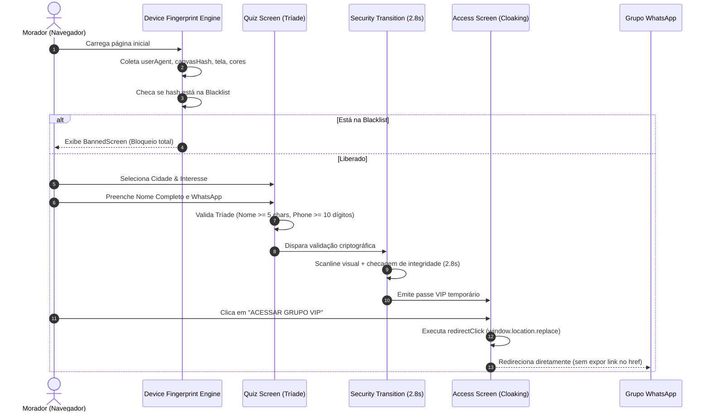

# 🏛️ ARQUITETURA TÉCNICA DO SISTEMA — DEU BRICK (V3.1)

Este documento detalha as especificações técnicas, diagramas conceituais, modelos de dados e fluxos de segurança do **Deu Brick**, servindo como referência arquitetural primária para desenvolvedores humanos e agentes de Inteligência Artificial.

---

## 1. Visão Geral dos Componentes

O Deu Brick é estruturado em três camadas complementares:

```
+-------------------------------------------------------------------------------+
|                           1. CLIENTE WEB (SPA)                                |
|   React 19 + TypeScript + Vite + Tailwind CSS + Lucide Icons                  |
|                                                                               |
|   +-------------------+  +---------------------+  +------------------------+  |
|   |   Funil de Telas  |  | Central Comunitária |  | Painel Administrativo  |  |
|   |  - Welcome        |  |  - Denúncias        |  |  - Blacklist & Tríade  |  |
|   |  - Quiz (Tríade)  |  |  - Regras           |  |  - Guerrilha (QR Code) |  |
|   |  - Scanline Sec.  |  +---------------------+  |  - Backup v1.0         |  |
|   |  - VIP Cloaking   |                           |  - WhatsApp API QG     |  |
|   +-------------------+                           +------------------------+  |
+-------------------------------------------------------------------------------+
                                      │
                                      ▼
+-------------------------------------------------------------------------------+
|                       2. CAMADA DE DADOS & RESILIÊNCIA                        |
|                                                                               |
|   +───────────────────────────+       Fallback        +───────────────────+   |
|   |   ApiStorageAdapter       | ────────────────────> | LocalStorageAdapt |   |
|   |  (REST / VITE_API_URL)    |   (Rede offline/erro) | (Offline-First)   |   |
|   +───────────────────────────+                       +───────────────────+   |
+-------------------------------------------------------------------------------+
                                      ▲
                                      │ Webhook / Pooling / Comandos
+-------------------------------------------------------------------------------+
|                   3. AGENTE LOCAL WHATSAPP / MODERAÇÃO                        |
|   Node.js + Baileys / Evolution API + Motor de Comandos                       |
|                                                                               |
|   - Deduplicação de Mensagens (TTL 60s)                                        |
|   - Rate Limiting (2.5s por chat)                                             |
|   - Execução de comandos: !status, !ban, !desban, !denuncia, !regras, !link   |
+-------------------------------------------------------------------------------+
```

---

## 2. Modelos de Dados (Entities & Schemas)

### 2.1 Tríade de Identidade (`TriadProfile`)
Armazenada em `deubrick_triad_profiles_v1`. Vincula a identidade do usuário ao hash do dispositivo.

| Campo | Tipo | Descrição |
|---|---|---|
| `id` | `string` (UUID) | Identificador único do perfil |
| `fullName` | `string` | Nome e sobrenome do morador (mín. 5 chars) |
| `whatsapp` | `string` | Telefone com DDD no formato BR `51999999999` |
| `fingerprintHash` | `string` | Hash SHA-like gerado a partir do navegador |
| `selectedCity` | `CityName` | Cidade escolhida no Quiz |
| `category` | `string` | Categoria de interesse comercial |
| `objective` | `ObjectiveType` | `comprar`, `vender`, `trocar` ou `anunciar` |
| `createdAt` | `string` (ISO 8601) | Data/hora do cadastro |
| `isBanned` | `boolean` | Flag de bloqueio rápido |
| `banReason` | `string` (opcional) | Motivo da penalização |

### 2.2 Blacklist (`BlacklistEntry`)
Armazenada em `deubrick_blacklist_v1`.

| Campo | Tipo | Descrição |
|---|---|---|
| `id` | `string` (UUID) | ID do bloqueio |
| `fingerprintHash` | `string` | Hash do dispositivo bloqueado |
| `phoneOrIdentifier` | `string` | Telefone ou identificador Pix associado ao golpista |
| `reason` | `string` | Motivo do banimento |
| `bannedAt` | `string` (ISO 8601) | Data e hora |
| `bannedBy` | `string` | Moderador responsável (ex: `QG Admin`, `Agente WhatsApp`) |
| `city` | `CityName \| 'Região Metropolitana'` | Cidade de atuação |
| `severity` | `'MEDIA' \| 'ALTA' \| 'CRITICA'` | Grau de risco |

### 2.3 Registro de Denúncia (`ReportEntry`)
Armazenada em `deubrick_reports_v1`.

| Campo | Tipo | Descrição |
|---|---|---|
| `id` | `string` (UUID) | Protocolo da denúncia |
| `targetPhone` | `string` | WhatsApp do suspeito |
| `suspectName` | `string` | Nome ou apelido do suspeito |
| `city` | `CityName` | Cidade onde ocorreu o fato |
| `category` | `string` | Golpe Pix, Produto Falso, Calote, etc. |
| `description` | `string` | Relato dos fatos |
| `evidenceImages` | `string[]` | Fotos/prints codificados em Base64 |
| `reportedAt` | `string` (ISO 8601) | Data do registro |
| `status` | `'pendente' \| 'investigando' \| 'confirmado' \| 'descartado'` | Estado da apuração |
| `reporterFingerprint`| `string` | Hash anônimo do denunciante para evitar spam |

### 2.4 Comandos de WhatsApp (`WhatsAppCommandLog`)
Armazenada em `deubrick_whatsapp_command_logs_v1`.

| Campo | Tipo | Descrição |
|---|---|---|
| `id` | `string` | ID único do evento |
| `command` | `string` | Comando acionado (ex: `!status`, `!ban`) |
| `senderPhone` | `string` | Número do remetente |
| `senderName` | `string` | Nome retornado pelo pushName do WhatsApp |
| `groupJid` | `string` | JID do grupo de origem (se aplicável) |
| `isAuthorized` | `boolean` | Indica se o remetente tinha nível de moderador |
| `payload` | `string` | Argumentos recebidos |
| `responseMessage` | `string` | Mensagem devolvida ao chat |
| `executedAt` | `string` (ISO 8601) | Carimbo de data/hora |
| `status` | `'sucesso' \| 'erro' \| 'ignorado'` | Desfecho da execução |

---

## 3. Fluxo de Execução e Segurança (Sequence)



---

## 4. Estratégia de Backup e Migração (Etapa 1A)

O formato de backup **Schema v1.0** exporta um payload JSON com as seguintes seções estritas:
1. `metadata`: Versão (`1.0.0`), timestamp ISO, gerador (`Deu Brick Admin QG`), total de registros.
2. `categories`: Dicionário com todas as chaves do `STORAGE_KEYS`.
3. `checksum`: Contagem por entidade para conferência em memória no painel antes e depois da gravação.

```json
{
  "version": "1.0.0",
  "exportedAt": "2026-03-30T12:00:00.000Z",
  "source": "Deu Brick Admin QG",
  "environment": "client-storage",
  "summary": {
    "cities": 7,
    "blacklist": 12,
    "reports": 4,
    "campaigns": 3,
    "triadProfiles": 45,
    "visitorLogs": 120,
    "whatsappCommandLogs": 18
  },
  "data": { ... }
}
```

---

## 5. Portabilidade e Compatibilidade Multiplataforma

O projeto foi construído para operar indistintamente em:
* **Google AI Studio / Cloud Run**: SPA Vite estática ou container Node.js.
* **Lovable / Replit**: Zero dependências de C++ nativo, Tailwind CSS padrão, compatível com qualquer bundler Vite.
* **Agente Baileys Desktop**: Script desacoplado rodando em Node.js no Windows com reconexão automática e QR Code no terminal.
